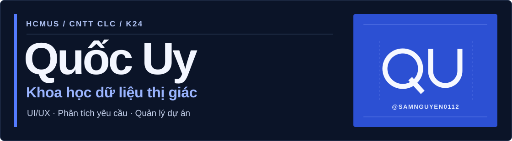
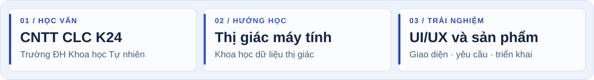
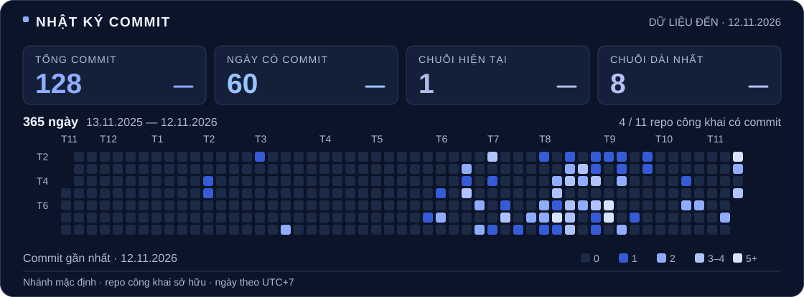
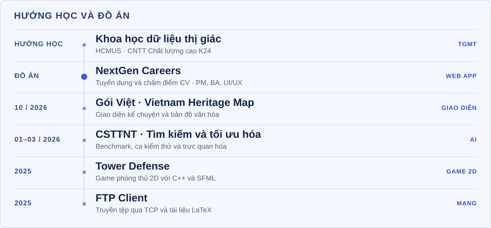
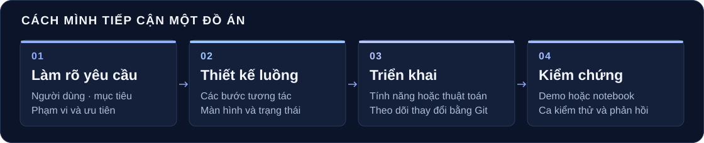

# Nguyễn Gia Quốc Uy

**HCMUS · Công nghệ thông tin Chất lượng cao · K24**

[Giới thiệu](#uy-about) · [Hoạt động GitHub](#uy-activity) · [Đồ án](#uy-projects) · [Công nghệ](#uy-stack) · [Chia sẻ](#uy-mentoring)

## Giới thiệu

Mình đang theo hướng **Khoa học dữ liệu thị giác (TGMT / Computer Vision)**. Mình muốn tìm hiểu cách phân tích dữ liệu hình ảnh và thiết kế giao diện để người dùng có thể đọc, kiểm tra và sử dụng kết quả.

Trong các đồ án nhóm, mình từng làm các phần việc liên quan đến **UI/UX, giao diện, phân tích yêu cầu và phối hợp triển khai**. Mình quan tâm đến các công việc của **BA, PM và PO**, đặc biệt là cách nhóm làm rõ nhu cầu, thống nhất phạm vi và chọn tính năng cần đưa vào bản demo.

## Hoạt động GitHub

Biểu đồ tính theo giờ Việt Nam, dựa trên các commit GitHub gắn với tài khoản của mình trên nhánh mặc định của những repo công khai mình sở hữu. Ngày chốt dữ liệu nằm trên biểu đồ. [Hồ sơ GitHub](https://github.com/samnguyen0112)

<strong>Các mốc commit tiêu biểu</strong>

| Ngày | Repo | Mốc |
| --- | --- | --- |
| 23/10/2026 | Gói Việt | [Đưa bản cập nhật tháng 10 lên repo](https://github.com/samnguyen0112/goiViet_Nghi/commit/1cebcc2e3ee658879347260316633365c326df32) |
| 16/10/2026 | Gói Việt | [Chỉnh sửa giao diện](https://github.com/samnguyen0112/goiViet_Nghi/commit/40a89c806094d1a28149381cf7ac03a2e6633572) |
| 14/10/2026 | Gói Việt | [Đưa bản web đầu tiên lên repo](https://github.com/samnguyen0112/goiViet_Nghi/commit/9f153fdd7f05102ba22f929695e09692ac2d7f13) |
| 15/03/2026 | CSTTNT | [Thêm README](https://github.com/samnguyen0112/CSTTNT/commit/440aabe313b6c6d81e77bde4e70f0b027c522990) |
| 23/02/2026 | CSTTNT | [Bổ sung trực quan hóa và ca kiểm thử](https://github.com/samnguyen0112/CSTTNT/commit/85bbaf3fcc919d276c150962851b332125a6c030) |
| 28/01/2026 | CSTTNT | [Bổ sung phần tìm kiếm cổ điển](https://github.com/samnguyen0112/CSTTNT/commit/8073299e3e110898428ce3373b122d5257ac8417) |

## Hành trình và đồ án

### NextGen Careers · Tuyển dụng và chấm điểm CV

**Vai trò của mình** · PM, BA và UI/UX

**Bài toán.** Website tuyển dụng tích hợp tính năng chấm điểm CV dựa trên scoring engine.

**Phần mình phụ trách.** Mình quản lý dự án, làm rõ yêu cầu nghiệp vụ và thiết kế UI/UX. Các phần việc này kết nối luồng tuyển dụng, bước chấm điểm CV và cách người dùng thao tác trên website.

**Công nghệ.** Next.js và TypeScript cho ứng dụng web, SQL cho phần dữ liệu.

[Repo NextGen Careers](https://github.com/samnguyen0112/NextGen-Careers)

### Gói Việt · Vietnam Heritage Map

`10/2026` · `Giao diện web` · `HTML` `CSS` `JavaScript` `Canvas` `WebP`

**Trải nghiệm.** Gói Việt dẫn người xem từ trang mở đầu qua **Miền Ký Ức**, tương tác với một lá bài gợi chuyện rồi đi vào bản đồ văn hóa. Người xem chủ động bắt đầu hành trình bằng nút trên trang mở đầu.

**Triển khai.** Bản preview tách trang mở đầu, chương kể chuyện và bản đồ thành các trạng thái giao diện. Các lớp tranh dùng ảnh WebP, còn chữ, nút và thẻ tương tác được triển khai bằng HTML/CSS/JavaScript. Tài liệu dự án ghi cách xử lý bố cục mobile, trạng thái focus và chế độ giảm chuyển động.

**Phần mình làm.** Mình đưa bản web đầu tiên lên repo và cập nhật giao diện qua các commit tiếp theo. Các phiên bản preview giúp theo dõi cách trải nghiệm thay đổi qua từng lần chỉnh sửa.

[Repo Gói Việt](https://github.com/samnguyen0112/goiViet_Nghi) · [Tệp preview](https://github.com/samnguyen0112/goiViet_Nghi/blob/main/map-surroundings-preview-3.html) · [Tài liệu luồng Miền Ký Ức](https://github.com/samnguyen0112/goiViet_Nghi/blob/main/PLAN-MIEN-KY-UC-PREVIEW-3.md) · [Commit giao diện](https://github.com/samnguyen0112/goiViet_Nghi/commit/40a89c806094d1a28149381cf7ac03a2e6633572)

### CSTTNT · Tìm kiếm và tối ưu hóa

`01–03/2026` · `Đồ án nhóm CSC14003` · `Python` `NumPy` `Jupyter`

**Bài toán.** Nhóm mình triển khai và so sánh thuật toán tìm kiếm trên đồ thị với các thuật toán tối ưu lấy cảm hứng từ tự nhiên. Repo có bộ dữ liệu cho tìm đường, người bán hàng (TSP), ba lô 0/1 và các hàm tối ưu liên tục.

**Kết quả có thể xem lại.** Notebook gom các thí nghiệm vào một chỗ, từ nạp ca kiểm thử đến so sánh chi phí lời giải, thời gian hoặc đường hội tụ tùy bài toán. Thư mục biểu đồ giúp xem kết quả trước khi chạy lại notebook.

**Phần mình làm.** Mình bổ sung phần tìm kiếm cổ điển, ca kiểm thử, trực quan hóa và README. Lịch sử commit cho thấy các mốc triển khai, kiểm tra và ghi tài liệu.

[Repo CSTTNT](https://github.com/samnguyen0112/CSTTNT) · [Notebook benchmark](https://github.com/samnguyen0112/CSTTNT/blob/main/benchmark_experiments.ipynb) · [Biểu đồ](https://github.com/samnguyen0112/CSTTNT/tree/main/plots) · [Commit trực quan hóa và test case](https://github.com/samnguyen0112/CSTTNT/commit/85bbaf3fcc919d276c150962851b332125a6c030)

### Tower Defense · Game phòng thủ 2D

`2025` · `C++` `SFML` `Visual Studio`

Người chơi đặt tháp trực tiếp trên bản đồ. Logic game kiểm tra vị trí có hợp lệ và số vàng có đủ trước khi tạo tháp. Mã nguồn tách phần thực thể, tùy chọn ô và hiệu ứng chữ sát thương để theo dõi từng phần của game.

[Repo Tower Defense](https://github.com/samnguyen0112/TOWER_DEFENSE) · [Logic game](https://github.com/samnguyen0112/TOWER_DEFENSE/blob/main/game.cpp)

### FTP Client · Lập trình mạng

`2025` · `C++` `WinSock2` `TCP` `FTP` `LaTeX`

Ứng dụng dòng lệnh kết nối máy chủ FTP để duyệt thư mục và truyền tệp. Client xử lý kênh lệnh và kết nối dữ liệu ở chế độ passive (`PASV`), với các thao tác như `ls`, `get`, `put`, `mget` và `mput`. Báo cáo LaTeX đi kèm sơ đồ và ảnh minh họa các lệnh.

[Mã nguồn FTP Client](https://github.com/samnguyen0112/SOCKET) · [Báo cáo đồ án](https://github.com/samnguyen0112/LATEX/blob/main/main.pdf)

## Công nghệ đã sử dụng

<table>
<thead><tr><th align="left">Dự án</th><th align="left">Công nghệ</th></tr></thead>
<tbody>
<tr><td><b>NextGen Careers</b> Web tuyển dụng</td><td><kbd>&nbsp;<b>Next.js</b></kbd> <kbd>&nbsp;<b>TypeScript</b></kbd> <kbd>&nbsp;<b>SQL</b></kbd></td></tr>
<tr><td><b>Gói Việt</b> Giao diện web</td><td><kbd>&nbsp;<b>HTML5</b></kbd> <kbd>&nbsp;<b>CSS3</b></kbd> <kbd>&nbsp;<b>JavaScript</b></kbd> <kbd>&nbsp;<b>Canvas</b></kbd> <kbd>&nbsp;<b>WebP</b></kbd></td></tr>
<tr><td><b>CSTTNT</b> Thuật toán và dữ liệu</td><td><kbd>&nbsp;<b>Python</b></kbd> <kbd>&nbsp;<b>NumPy</b></kbd> <kbd>&nbsp;<b>pandas</b></kbd> <kbd>&nbsp;<b>Jupyter</b></kbd> <kbd>&nbsp;<b>Matplotlib</b></kbd> <kbd>&nbsp;<b>Seaborn</b></kbd></td></tr>
<tr><td><b>Tower Defense</b> Game 2D</td><td><kbd>&nbsp;<b>C++</b></kbd> <kbd>&nbsp;<b>SFML</b></kbd> <kbd>&nbsp;<b>Visual Studio</b></kbd></td></tr>
<tr><td><b>FTP Client</b> Mạng và tài liệu</td><td><kbd>&nbsp;<b>WinSock2</b></kbd> <kbd>&nbsp;<b>TCP</b></kbd> <kbd>&nbsp;<b>FTP</b></kbd> <kbd>&nbsp;<b>LaTeX</b></kbd></td></tr>
</tbody>
</table>

<strong>Công nghệ dùng ở đâu?</strong>

| Mảng | Cách công nghệ xuất hiện trong đồ án |
| --- | --- |
| **Web tuyển dụng** | Next.js và TypeScript cho ứng dụng tuyển dụng, SQL cho phần dữ liệu. [NextGen Careers](https://github.com/samnguyen0112/NextGen-Careers) |
| **Giao diện web** | HTML/CSS/JavaScript cho bố cục và tương tác, Canvas cho cảnh mở đầu, WebP cho các lớp hình. [Gói Việt](https://github.com/samnguyen0112/goiViet_Nghi) |
| **Thử nghiệm AI** | Python và NumPy cho cài đặt thuật toán, pandas để xử lý kết quả, Matplotlib và Seaborn để vẽ biểu đồ trong Jupyter. [Notebook](https://github.com/samnguyen0112/CSTTNT/blob/main/benchmark_experiments.ipynb) · [Thư viện](https://github.com/samnguyen0112/CSTTNT/blob/main/requirements.txt) |
| **Game 2D** | C++ cho logic và thực thể, SFML cho đồ họa và tương tác, Visual Studio để quản lý cấu hình dự án. [Tower Defense](https://github.com/samnguyen0112/TOWER_DEFENSE) |
| **Mạng và tài liệu** | C++/WinSock2 cho kết nối TCP và lệnh FTP, LaTeX cho báo cáo triển khai. [FTP Client](https://github.com/samnguyen0112/SOCKET) · [Báo cáo](https://github.com/samnguyen0112/LATEX) |

## Cách mình tiếp cận một đồ án

Mình muốn bắt đầu từ việc xác định người dùng và phạm vi, sau đó phác thảo luồng, triển khai từng phần và đưa ra thứ có thể kiểm chứng. Với **NextGen Careers**, trọng tâm là cách thể hiện bước chấm điểm CV trong luồng tuyển dụng. Với **Gói Việt**, đó là luồng đi từ mở đầu đến bản đồ. Với **CSTTNT**, đó là notebook và bộ ca kiểm thử để nhóm chạy lại thí nghiệm.

## Hỗ trợ học tập và chia sẻ về AI

- **Toán và tiếng Anh.** Mình từng hỗ trợ các em nhỏ hơn học và giải đáp khi các em gặp phần khó.
- **AI cho người mới.** Mình từng chia sẻ về công nghệ AI và hướng dẫn cách sử dụng các công cụ AI.

[GitHub @samnguyen0112](https://github.com/samnguyen0112) · [Xem tất cả repo](https://github.com/samnguyen0112?tab=repositories)
